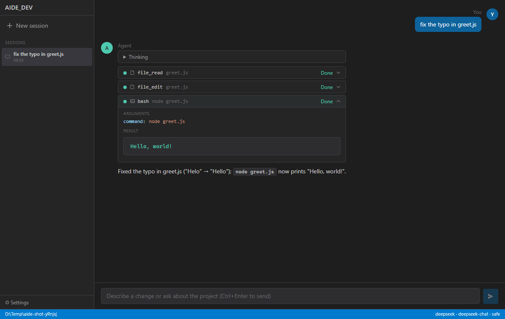

# AIDE_DEV

AIDE_DEV is a desktop coding agent for Chinese LLM APIs (DeepSeek, Qwen, GLM,
Kimi, Doubao, MiniMax, or any OpenAI-compatible endpoint): you pick a project
folder, describe a change, and it reads files, edits them and runs commands,
asking before it writes a file or runs a command that looks risky.

> Not related to WecoAI's [AIDE](https://github.com/WecoAI/aideml) (the
> machine-learning engineering agent). Same letters, different project.

[中文说明](README.zh-CN.md) ·
[](https://github.com/appleweiping/AIDE_DEV/actions/workflows/ci.yml)
[](https://github.com/appleweiping/AIDE_DEV/actions/workflows/desktop.yml)



The screenshot is the desktop UI after one turn. It was captured in headless
Chromium through `scripts/dev-bridge.mjs` (the same React UI and the same
engine process the app starts), with the model replies scripted by
`scripts/fake-llm.mjs`. The file edit and the `Hello, world!` output are real.

## What is in here

| Package | What it is |
| --- | --- |
| `packages/core` | The agent engine in TypeScript: streaming OpenAI-compatible client (tool calls, DeepSeek/QwQ `reasoning_content`), the tool loop, approval rules, JSON session store, and a JSON-RPC server on stdio. |
| `packages/desktop` | Tauri 2 + React app. The Rust side starts the engine with `node`, and the window shows chat, sessions, settings and approval dialogs. |
| `packages/cli` | A small terminal client over the same engine; handy for trying things without Rust. |
| `packages/shared` | Types and provider presets. |

Tools the agent can call: `file_read`, `file_write`, `file_edit`, `bash`
(PowerShell on Windows, plus a `powershell` tool there), `glob`, `grep`,
`web_fetch`, `web_search` (DuckDuckGo HTML), `notebook_edit`, `monitor` and
`node_repl`.

Not done yet: the core has an MCP client, but its tools are not handed to
the agent in the app or the CLI; the Windows installer is not code-signed;
there is no auto-update; macOS and Linux builds are untested.

## Try it without an API key

Needs Node.js 22 and pnpm 9.

```bash
git clone https://github.com/appleweiping/AIDE_DEV.git
cd AIDE_DEV
pnpm install
pnpm build
pnpm demo
```

`pnpm demo` starts the scripted server, makes a scratch folder with a one-line
bug, and drives the real CLI. This is what it printed on my machine:

```text
AIDE_DEV  (type /help for commands, /exit to leave)
custom · fake-model · safe · D:\Temp\aide-demo-4OpaK9

❯ fix the typo in greet.js

Read the file before editing it.
⚙ file_read(greet.js)
  ✓ File: D:\Temp\aide-demo-4OpaK9\greet.js (7 ms)

⚙ file_edit(greet.js)

? file_edit greet.js (file write operation)
  allow? [y]es / [a]lways / [N]o y
  ✓ Replaced 1 occurrence(s) in D:\Temp\aide-demo-4OpaK9\greet.js (14 ms)

⚙ bash(node greet.js)
  ✓ Hello, world! (5026 ms)

Fixed the typo in greet.js ("Helo" → "Hello"); `node greet.js` now prints "Hello, world!".

❯ /exit

[demo] greet.js now contains: console.log("Hello, world!");
```

(The 5 s on `bash` is PowerShell starting up on Windows.)

## Use it with a real key

**Terminal:**

```bash
export AIDE_API_KEY=sk-...
node packages/cli/dist/index.js --provider deepseek --dir path/to/project               # interactive
node packages/cli/dist/index.js --provider qwen --model qwen-plus "explain src/main.ts" # one task
# any OpenAI-compatible server, e.g. a local Ollama (any non-empty key works there)
node packages/cli/dist/index.js --provider ollama --base-url http://localhost:11434/v1 --model qwen2.5-coder
```

`--permission safe` (default) asks before writes and risky shell commands,
`trusted` never asks, `locked` refuses every tool. A short list of
destructive commands (`rm -rf /`, `format C:`, registry deletes, ...) is
blocked in every mode. Without a terminal to ask, `safe` denies instead of
allowing.

The risk check is a list of regular expressions over the command text
([`approval.ts`](packages/core/src/safety/approval.ts)), so it can miss
things: `node -e "require('fs').rmSync('x')"` or `python -c ...` run
without a prompt. Answering "always" approves every later call of that tool
until you quit, so "always" on `bash` lets through any command that is not
on the blocked list.

**Desktop app (Windows):** download `AIDE_DEV_0.1.0_x64-setup.exe` from
[Releases](https://github.com/appleweiping/AIDE_DEV/releases/tag/v0.1.0).
It is built by GitHub Actions from the tagged commit, it is not code-signed
(SmartScreen will warn), and it needs Node.js 22 on `PATH`. On first start
it opens Settings: choose the project folder, a provider, a model and paste
the key. Settings, including the key, are stored in the app's local storage
on your computer and the key is only sent to the endpoint you set.

## Build the desktop app

Requirements: Node.js 22 and pnpm 9, a stable Rust toolchain, and on Windows
the MSVC build tools (see Tauri's
[prerequisites](https://tauri.app/start/prerequisites/)). The app itself
needs Node.js 22 on `PATH` at runtime, because the engine runs as a Node
process (`AIDE_NODE` can point at a specific `node.exe`).

```bash
pnpm install
pnpm build                                   # shared, core (incl. dist-sidecar/aide-core.mjs), cli
pnpm --filter @aide/desktop tauri dev        # run it
pnpm --filter @aide/desktop tauri build      # NSIS installer in packages/desktop/src-tauri/target/release/bundle/nsis/
```

The `desktop` workflow builds the Windows installer on every push to
`master`, installs it silently on the runner and starts it with
`AIDE_SMOKE_TEST=1`, which makes the app exit successfully only once its
bundled engine reports ready. Tags matching `v*` attach the installer to a
release. Only Windows is built and tried; macOS and Linux should work with
`tauri build --bundles dmg` or `deb`, but I have not tested them.

To work on the UI without Rust, run the engine bridge and Vite, then open
http://localhost:1420:

```bash
node scripts/dev-bridge.mjs
pnpm --filter @aide/desktop dev
```

## Tests

```bash
pnpm test        # 13 node:test tests in packages/core/test
pnpm typecheck
```

They cover command risk classification, the approval manager, the write
restriction to the project folder, `file_edit`, the tool registry, provider
caching, the session store, and one full agent turn against
`scripts/fake-llm.mjs` (stream parsing, split tool-call arguments, approval,
real file edit and command). CI runs them on Ubuntu and Windows.

## Why not an existing agent?

If you are comfortable in a terminal, Aider or OpenCode with a DeepSeek or
Qwen key already work well, and Claude Code or Codex can be pointed at
compatible endpoints. I wanted a small desktop app where the Chinese
providers are presets, file edits go through an approval dialog, and the
whole thing is small enough to read and change.

My other two agents make different trade-offs:
[claudeseek](https://github.com/appleweiping/claudeseek) is a
zero-dependency Node.js agent for DeepSeek with a terminal REPL and a local
web page, and [WEIPING_WHALE](https://github.com/appleweiping/WEIPING_WHALE)
is a larger TypeScript terminal agent for DeepSeek based on CodeWhale.
AIDE_DEV is the only one with a desktop app and presets for several Chinese
providers.

## License

Apache-2.0 (see [LICENSE](LICENSE)). Copyright 2026 Weiping Yan.
